<!--
  This profile is intentionally rendered as a generated SVG so every visible
  letter follows one consistent typography system. Run:

      node scripts/update-readme.mjs

  The scheduled GitHub Action also refreshes it automatically.
-->

  
    
  
  &nbsp;&nbsp;&nbsp;
  
  &nbsp;&nbsp;&nbsp;
  
  &nbsp;&nbsp;&nbsp;
  

  <strong><a href="https://ai-ml-engineering-from-scratch.vercel.app/">ai-ml-engineering-from-scratch.vercel.app</a></strong>

